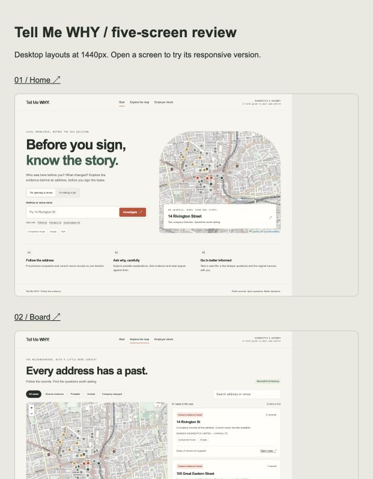

# 🔎 Tell Me WHY — who failed here before you, and why?

**Before you sign a 10-year lease, see every business that closed at this address, checked twice, with the reasons as evidence-backed hypotheses.
Before you take the shift, check whether the company behind the venue is still alive.
Code finds every fact. Gemini explains them. A second check makes sure a "closure" isn't just a new company behind the same restaurant.**

[](LICENSE)
· Built for **Encode London Hackathon 2026** — track: **The Real World**
· **MongoDB Atlas** + **Google Gemini** (`gemini-4-argon`)

> 🎬 **Demo video (3 min):** ⏳ the link goes here before submission
> 🌐 **Live app:** ⏳ Vercel link goes here
> 🖼️ **Screens:** [what you see](#what-you-see)

---

## The problem

You find a lovely unit for your café. The agent says the last tenant "moved on". What you don't know:

- that **three food companies** were registered and dissolved at this exact address in seven years, one of them within nine months;
- whether they failed because of the **place** (no evening footfall, ten competitors within 150 m) or because of the **operator**;
- that the place is **still trading** under a new company, so the "closure" was a company swap, not a failure.

Location intelligence exists, but it is sold to chains and investors at "price on request", and it answers *"where should I open?"*, never *"why did they close here?"*.
Small tenants in the UK mostly rely on the landlord's agent — the side that wants the deal signed.

And there is a second person nobody protects: **the worker**. A venue can look open and busy while the company that employs its staff is already dissolved or in liquidation. People lose wages that way. It happened to me.

**Why me:** 15+ years in hospitality, venues opened in several countries, 40+ sites. These are the questions I asked before every lease, and had to answer by hand.

---

## Two people, one investigation board

| | 🏪 **"I'm opening a venue"** | 🧑‍🍳 **"I'm taking a job"** |
|---|---|---|
| Asks | Who failed at this address before me, and why? | Is the company behind this venue still alive? |
| Enters | a street, address or venue name | a venue name |
| Gets | a map of closures + a **case file** per address: the chain of companies, how long each lasted, whether the closure is confirmed, 2–3 hypotheses for *why* with evidence, confidence and a counter-argument | a **traffic light** with signals from public records, questions to ask before the first shift, and where to get help (Acas, HMRC, Redundancy Payments Service, Citizens Advice) |

**Traffic-light rule (worker mode):** 🟡 *needs verification* for anything inferred from company changes — it is a signal, not a fact. 🔴 only when Companies House confirms an insolvency procedure (liquidation, administration, receivership). 🟢 when our data shows no signals, which is not a guarantee.

**A real case file — 14 Rivington St, Shoreditch** (210 m from Encode Hub). Dates are the companies' registration and dissolution, not the venues' trading life — we never present one as the other:

- Nanashi Shoreditch Ltd · company 2017-11 → 2021-05 (42 months) · venue **closed permanently** — Google, rated 4.5 (285 reviews)
- Chingu Ltd (Korean fried chicken & ramen) · company 2024-03 → 2026-01 (22 months) · venue **temporarily closed** — Google, rated 4.6 (18 reviews)
- Around it: 85 venues on Google within 150 m, neighbours' median rating 4.5, Old Street station 380 m
- Gemini's headline: *"Two consecutive well-rated Asian dining concepts closed at 14 Rivington St within 22–42 months amid fierce local competition."* Every hypothesis cites the numbers above and comes with a counter-argument.

**A real employer check — Schnitzel Heaven, 57 Pitfield St:** 🟡 *needs verification* — three companies at the address; the latest one was dissolved in Sept 2026 while the venue still trades (FSA + Google). For staff: ask who your employer is on paper.

---

## What you see

Five screens, light and calm, built mobile-first (people open it from a QR code in the room):

1. **Home** — *"Before you sign, know the story."* One search box, two modes: *I'm opening a venue* / *I'm taking a job*.
2. **Board** — *"Every address has a past."* Map of the neighbourhood and the list of case files, filtered by verdict: closure evidence · probable · unclear · company changed.
3. **Case file** — the chain of companies with a verdict and a source for each; the venues' **trading names, format and cuisine, Google rating, FSA hygiene score and price range** as separate badges (a current tenant's score is never carried back to a past one); the hypotheses with evidence and counter-arguments; and **"Will the space work for your concept?"** (below).
4. **Employer check** — signals for a venue name, questions to ask, where to get help.
5. **Share** — a link and a real QR code for a case file, to send to a partner or a broker.

**"Will the space work for your concept?"** A previous restaurant is not proof that yours is allowed. The case file separates three checks — **lawful use class** (old A-classes vs. today's Class E), **installed extraction**, and **suitability for your equipment** — and changes the questions for a coffee shop, a bakery with on-site baking or a hot kitchen. Each stays *Not verified / Assessment needed* until documents exist; official guidance (GOV.UK, Planning Portal, HSE, Hackney) is linked.

[](design/review.html)

<sub>Design prototype in `design/` (open `design/review.html`). Ratings and the space check: [design/assets/venue-ratings-preview.png](design/assets/venue-ratings-preview.png).</sub>

---

## How it works

[](docs/diagrams/how-it-works.svg)

1. **Collect.** Dissolved food & drink companies (SIC 56xxx) from Companies House, all food businesses from the FSA hygiene register, venues with hours, prices and reviews from Google Places, stations from TfL, demographics from ONS Census 2021. Everything goes into MongoDB Atlas.
2. **Group by address** into chains: who traded here, in what order, for how long. Addresses with more than six companies (accountants, registered-office services) are dropped.
3. **Verify every company** (`scripts/verify_closures.py`) — see below.
4. **Compute context in code:** nearest station, venues within 150 m, share of neighbours open after 21:00 and on Sundays, neighbours' median Google and hygiene ratings.
5. **Gemini writes hypotheses** over those facts only, as strict JSON: headline, 2–3 hypotheses (each with evidence, confidence and a counter-argument), the chain pattern, and a caveat.
6. **The app** reads a snapshot (`app/data/`), so the demo never waits on a network call. Vercel functions serve the same data as an API.

---

## Verify, then explain: why we don't trust a dissolved company

Restaurants change the company behind them all the time: new partners, tax, restructuring. If we called every dissolved company a closure, the board would be full of "failures" that are still serving dinner.
So **every company in every chain is checked against the real world before it counts:**

1. Is a venue with the same name trading **within 45 m** right now? (FSA + Google in our database)
2. If not, ask **Google Places** by name near the address: is it `CLOSED_PERMANENTLY`, `CLOSED_TEMPORARILY` or `OPERATIONAL`? (results cached, so re-running costs nothing; `--refresh` re-checks)

| Verdict | Meaning | Companies (of 83) |
|---|---|---|
| `closed_google` | closure **confirmed** by Google | 4 |
| `operating_now` | **same venue still trading** — company changed, not a closure | 9 |
| `no_trace` | name looks like a venue, no trace anywhere — probably closed | 19 |
| `unclear` | no trace and the name doesn't say what it was — **not counted** as a closure | 51 |

Each address then gets a level: **confirmed** (3) · **probable** (18) · **possible** (34) · **company changed, venue open** (6).
The same verdict means different things to different people: for a tenant, `operating_now` is good news (the place survives); for a worker, it is a red flag (the employer company is gone while the venue trades on).

---

## How we use Google Gemini

| | |
|---|---|
| **Model** | `gemini-4-argon` via the Gemini API |
| **Mode** | structured output: `responseMimeType: application/json` + `responseSchema`, temperature 0.3 |
| **Task** | turn a fact sheet about one address into a case file: headline, hypotheses with evidence / confidence / counter-argument, chain pattern, caveat |
| **Where in the code** | `scripts/gen_reasons.py` → `gemini()`, `PROMPT`, `SCHEMA` |

### Why the model can't make things up

- **It never sees raw data and never counts.** It gets a fact sheet the code already computed: the chain with dates and lifespans, each company's verification verdict, the context numbers, who trades nearby now.
- **Facts only.** The prompt forbids anything outside the fact sheet; we have no reviews for closed places, and the model is told so.
- **Every hypothesis must cite facts** (a number or a name from the sheet) and must carry a **counter-argument**.
- **Verdicts it must respect:** `operating_now` is never called a closure; `unclear` is never called a closure; confidence can't be `high` unless a closure is confirmed by Google.
- **Registered-office trap:** if lifespans look templated or names don't look like venues, the model must lower confidence and say so in the caveat.
- **A reason is a hypothesis, not a fact.** UK defamation risk is real; the UI says *"hypotheses, not facts"* above every reason.

⏳ **Not yet:** automatic post-checks of every number in the output and a blind evaluation against a code-only template (the approach that worked in my previous hackathon project). Planned next.

---

## How we use MongoDB Atlas

Database `deadspot` on Atlas:

| Collection | What | Documents |
|---|---|---|
| `places` | FSA food hygiene register (E1, E2, E8, N1, EC2) | 3,937 |
| `google` | Google Places venues: hours, price range, rating, reviews | 1,107 |
| `companies` | dissolved food & drink companies, Companies House | 6,302 |
| `stations` | TfL tube and rail stations | 54 |
| `areas` | ONS Census 2021 by LSOA: age, employment, tenure | 174 |
| `cases` | case files: chain, verification, context, Gemini analysis | 61 |

| Atlas feature | Role in the product | Status |
|---|---|---|
| **2dsphere geo indexes** | "everything within 150 m of this address", nearest station | ✅ live |
| **Atlas Search** (`google_text`) | full-text search over venue names, addresses and reviews | ✅ live |
| **Vector Search + Automated Embedding** (`cases_autoembed`, Voyage) | find case files by meaning; embeddings recompute whenever an analysis is rewritten | ✅ live — the query *"fried chicken shop closed fast"* returns **29 Pitfield St** (Taste of Tennessee → Hot Fried Chicken) first |
| Hybrid search, Stream Processing (live re-scoring when a new closure arrives) | | ⏳ planned |

The free M0 tier allows two search indexes, so they went where they matter most: reviews and case files.

---

## Run it

```bash
npm run dev
```

Opens on http://localhost:3000. No build step, no dependencies for the app.

**API** (Vercel functions in `api/`, same data as the app):
`/api/cases` · `/api/cases?level=confirmed` · `/api/case?id=14-rivington-st-EC2A3DU` · `/api/employer-check?q=Schnitzel%20Heaven`

**Data pipeline** (Python 3, `pip install pymongo`):

```
scripts/collect_*.py        → data/ (FSA, TfL, Google Places, Companies House, ONS)
scripts/load_atlas.py       → MongoDB Atlas (database deadspot) + geo indexes
scripts/build_cases.py      → chains of companies per address
scripts/verify_closures.py  → verdict for every company (Google Places + FSA)
scripts/gen_reasons.py      → context + Gemini hypotheses, exports app/data/cases.json
scripts/make_indexes.py, make_vector.py → Atlas Search + Vector Search
```

Secrets live in local git-ignored files (`*_key.txt`, `atlas_user.txt`, `atlas_password.txt`) — never in the repository.

---

## Honesty and safety

- **Hypotheses, not accusations.** Every reason has a confidence level and a counter-argument; every fact has a source badge and a check date.
- **Company changes can be ordinary.** The employer check says so on every result. It is not legal advice.
- **Public data only:** Companies House, FSA, Google Places, TfL, ONS. No personal data about workers or owners beyond what Companies House publishes.

## Known limitations

- **Registered office ≠ trading address.** That is why 51 of 83 companies end up `unclear` and are not shown as closures.
- **Google rarely lists closed places** in search; closures are confirmed only when Google still holds the closed listing (4 so far).
- **One neighbourhood:** about 400 m around Encode Hub. The sources are national, so the method scales; the dataset doesn't yet.
- **No rent data yet.** The "customers per day you'd need vs. what the street gives" calculation needs VOA rateable values.
- **Directors and insolvency notices** (Gazette, liquidation status) are not connected yet, so the employer check sees dissolutions, not ongoing liquidations.
- **Use class and extraction** are not known for any address yet: the space check is a due-diligence list, not a planning or engineering assessment.
- Food hubs and dark kitchens (e.g. 86–90 Paul Street) hold many companies at one address and still add noise.

---

## Built during the hackathon

✅ **Done:**
- Data for the Encode Hub neighbourhood from five public sources, loaded into MongoDB Atlas.
- Chains of companies per address and **verification of every company** against Google Places and FSA.
- Gemini case files with structured output, evidence, confidence and counter-arguments, in English.
- Geo indexes, Atlas Search and **Vector Search with Automated Embedding** — live.
- Web app: owner board (map, filters, case files) and **employer check** for workers; API for Vercel.
- Five-screen design: venue ratings (Google, FSA, price) without back-filling history, the **space check** (use class, extraction, equipment) for three concepts, share via link and QR.

🔄 **In progress:**
- Moving the app onto the new design, deploy to Vercel, QR code for the room, demo video.

## Repository structure

```
app/        the web app: index.html, app.js, lib/employer.js (shared with the API), data/ (snapshot)
api/        Vercel functions: cases, case, employer-check
design/     design prototype: 5 screens, tokens, components, venue details (build_venue_details.py)
scripts/    data pipeline: collect → load → build → verify → explain → index
```

## Roadmap

- **Employer check v2:** liquidation and administration status (the only thing that turns the light red), Gazette winding-up notices, same directors behind the old and the new company
- **"What if?" sandbox:** change hours, price or concept and watch the risk change, with the reason
- **Pre-mortem:** "it closed after 14 months — why?", three plausible stories built from real nearby cases
- **"I know something the data doesn't":** the user corrects a fact (rent, a free-rent period) and the analyst changes its mind, explaining why
- **Rent maths** from VOA rateable values: customers per day you'd need vs. what the street gives
- Stream Processing: a new closure nearby re-scores the address live; watch an address
- From one neighbourhood to all of London, then the UK

## How we built it

Solo build. Product, data decisions and hospitality know-how: Julia. Code and data pipeline written with **Claude Code**; design prototype made with **ChatGPT**. Every number in this README was checked against the data.

## License

[MIT](LICENSE) © 2026 Julia Zabrodska
