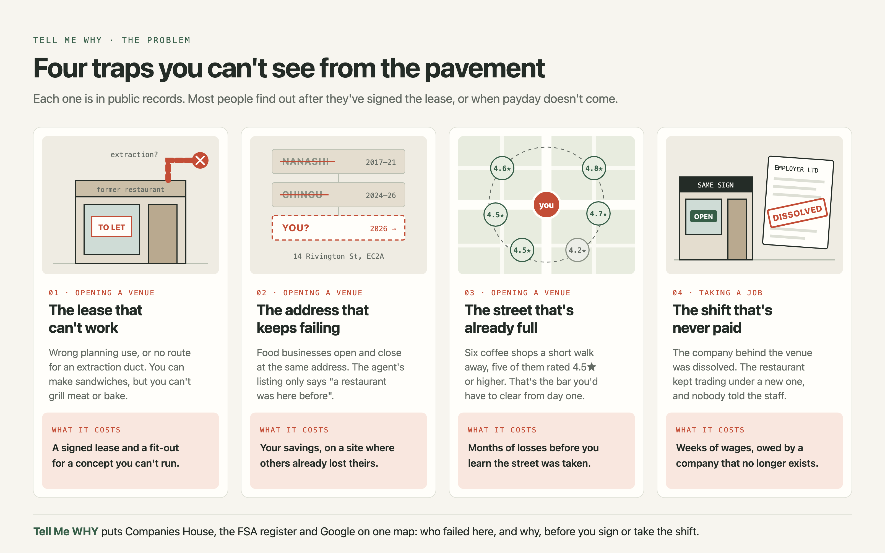
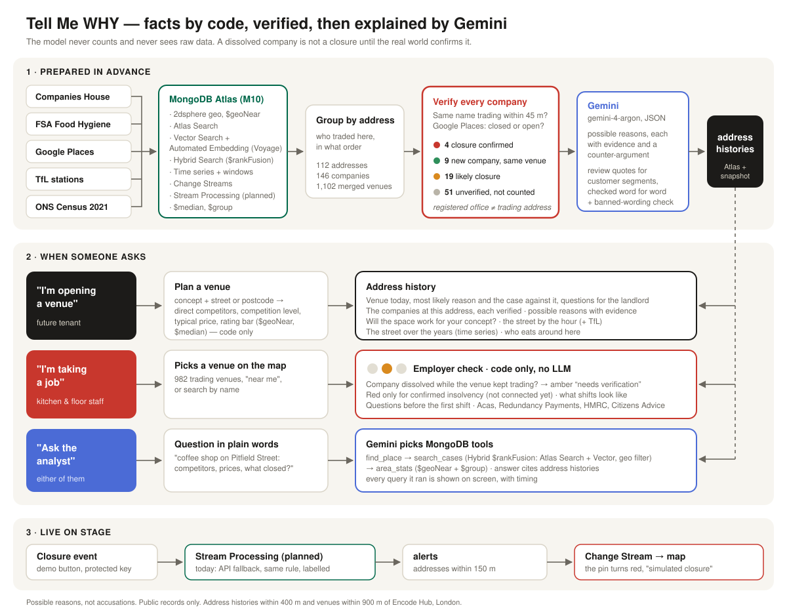
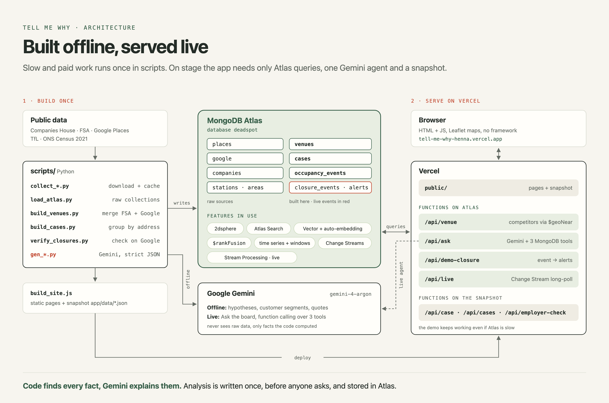
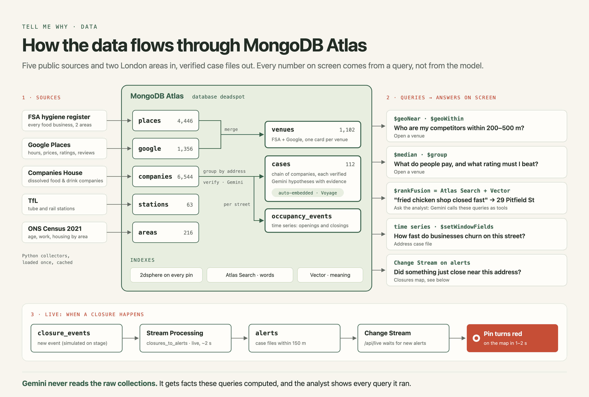

# 🔎 Tell Me WHY — who failed here before you, and why?

**Before you sign the lease or take the shift, see who failed here before you, and why.**

Every business that closed at an address, checked twice, with the reasons as evidence-backed hypotheses. Every company behind a venue, and whether it is still alive. Code finds every fact, Gemini explains them, and a second check makes sure a "closure" isn't just a new company behind the same restaurant.

[](LICENSE)
· Built for **Encode London Hackathon 2026** — track: **The Real World**
· **MongoDB Atlas** + **Google Gemini** (`gemini-4-argon`)

> 🎬 **Demo video (3 min):** https://www.youtube.com/watch?v=xyGk52dv0rI
> 📊 **Pitch deck:** [Google Slides](https://docs.google.com/presentation/d/1o20CYvVTPdzVOFBTOvGFV1znidv6sUZXJOBDgP42hxM/edit?usp=sharing)
> 🌐 **Live app:** https://tell-me-why-henna.vercel.app
> 📋 **Screens:** [what you see](#what-you-see)

## For judges: 60 seconds

[](https://www.youtube.com/watch?v=xyGk52dv0rI)

| Try it live | What you'll see |
|---|---|
| [**Open a venue:** a coffee shop on Pitfield Street](https://tell-me-why-henna.vercel.app/plan.html?concept=coffee&q=Pitfield%20Street) | direct competitors, what they charge, the rating bar to beat, closures nearby (`$geoNear`, `$median`) |
| [**Case file:** 14 Rivington St](https://tell-me-why-henna.vercel.app/case.html?id=14-rivington-st-EC2A3DU) | two restaurants in a row, each closure checked against Google; Gemini's hypotheses with evidence and a counter-argument |
| [**Ask the analyst:** "fried chicken closed fast near Old Street"](https://tell-me-why-henna.vercel.app/ask.html?q=Which%20fried%20chicken%20places%20closed%20fast%20near%20Old%20Street%2C%20and%20why%20might%20that%20be%3F) | Gemini picks MongoDB tools itself and lists every query it ran: Hybrid Search (`$rankFusion`), `$geoNear`. Takes ~15 s |
| [**Take a job:** Schnitzel Heaven](https://tell-me-why-henna.vercel.app/employer.html?q=Schnitzel%20Heaven) | the company behind it was dissolved while the venue still trades: amber, not red |

- **Impact.** First-time hospitality owners and staff carry the cost of a bad lease or an unpaid shift; both happened to me. Chains pay consultants for what this shows from public records.
- **Technical execution.** 112 case files and 1,102 venues across two London areas, from five public sources, in MongoDB Atlas. 7 Atlas features live — [see the table](#how-we-use-mongodb-atlas).
- **Innovation.** Verify, then explain: a dissolved company counts as a closure only after Google and the FSA are checked. Gemini writes hypotheses, never facts, each with a counter-argument.
- **Usability.** One address, one screen, mobile first. A QR code in the room opens *Near you* with no typing.

---

## The problem



### 1. The lease that couldn't work

We signed for a unit. It looked right: good street, fair rent, a restaurant had been there before.
Nobody told us it did not have the permissions our concept needed. We found out after signing — and finding out cost us a lot of money.

That is how small business owners learn this: **the hard way, one lease at a time.** Chains pay consultants and location-intelligence platforms ("price on request") to see this. A first-time owner has the landlord's agent — the side that wants the deal signed.

**Tell Me WHY helps you choose the right place:** who was here before you, what went wrong for them, and what to check about the space before you sign.

### 2. The shift that was never paid

I wasn't paid for my work. The company that employed me had been **dissolved** — and I didn't know.
The restaurant kept trading. The owners simply moved it to **a new company** and carried on. Other people kept coming in for extra shifts, not knowing they would never be paid either: their employer, on paper, no longer existed. The only trace is in Companies House — if you know to look, and know what you're looking at.

**Tell Me WHY lets anyone check a venue before the first shift:** has the company behind it changed, did the old one disappear while the venue kept trading, and what to ask before you start.

**Why me:** 15+ years in hospitality, 7 venues opened in several countries — and both of these happened to me.

---

## Two people, one investigation board

| | 🏪 **"I'm opening a venue"** | 🧑‍🍳 **"I'm taking a job"** |
|---|---|---|
| Asks | Who failed at this address before me, and why? | Is the company behind this venue still alive? |
| Enters | a street, address or venue name | a venue name |
| Gets | a map of closures + a **case file** per address: the chain of companies, how long each lasted, whether the closure is confirmed, 2–3 hypotheses for *why* with evidence, confidence and a counter-argument | a **traffic light** with signals from public records, questions to ask before the first shift, and where to get help (Acas, HMRC, Redundancy Payments Service, Citizens Advice) |

**Traffic-light rule (worker mode):** 🟡 *needs verification* for anything inferred from company changes — it is a signal, not a fact. 🔴 only when Companies House confirms an insolvency procedure (liquidation, administration, receivership). 🟢 when our data shows no signals, which is not a guarantee.

**A real case file — 14 Rivington St, Shoreditch** (210 m from Encode Hub). Dates are the companies' registration and dissolution, not the venues' trading life — we never present one as the other:

- Nanashi Shoreditch Ltd · company 2017-11 → 2021-05 (42 months) · venue **closed permanently** — Google, rated 4.5 (285 reviews)
- Chingu Ltd (Korean fried chicken & ramen) · company 2024-03 → 2026-01 (22 months) · venue **temporarily closed** — Google, rated 4.6 (18 reviews)
- Around it: 85 venues on Google within 150 m, neighbours' median rating 4.5, Old Street station 380 m
- Gemini's headline: *"Two consecutive well-rated Asian dining concepts closed at 14 Rivington St within 22–42 months amid fierce local competition."* Every hypothesis cites the numbers above and comes with a counter-argument.

**A real employer check — Schnitzel Heaven, 57 Pitfield St:** 🟡 *needs verification* — three food companies registered at the address since 2019 (two of them look like venues); the latest one was dissolved in Sept 2026 while the venue still trades (FSA + Google). For staff: ask who your employer is on paper.

---

## What you see

Eight screens, light and calm, built mobile-first (people open it from a QR code in the room):

1. **Home** — *"Before you sign, know the story."* One search box, two modes: *I'm opening a venue* / *I'm taking a job*.
2. **Open a venue** — pick a concept (coffee shop, bakery, restaurant, takeaway, bar) and a street, address or postcode. You get **how many direct competitors** are within 200–500 m, **how high the competition is** compared with the rest of the neighbourhood, the **typical price per person**, the rating and hygiene bar to clear, who eats around there, and the case files nearby. With no concept chosen, it shows what trades around the place.
3. **Address case file** — *In short* first: the venue today, the most likely reason and the case against it, questions for the landlord. Then the companies at the address, each verified; possible reasons with evidence and counter-arguments; and, folded away, *Will the space work for your concept?*, the street by the hour and the street over the years.
4. **Take a job** — pick a trading venue on the map (or *Near me*, or by name). It names the likely legal employer (the active company matched to the venue) with its Companies House number to check against the contract. If a company behind it was dissolved while the venue trades on, a plain fact card says so; then what the shifts may look like, four questions to ask, and where to get help (Acas, Redundancy Payments Service, HMRC, Citizens Advice).
5. **Closures map** — every case file on the map, for Shoreditch & Hoxton or Richmond & St Margarets, filtered by *Closure confirmed · Likely closure · Unverified · New company, same venue*.
6. **Ask the analyst** — a question in plain words; Gemini answers with MongoDB tools and shows every query.
7. **Venue report** (`venue.html`) — one page per café, restaurant or bar (1,102): Google rating and reviews, FSA hygiene, price, **who runs it** (every food company at the address or under its trading name, active and dissolved, with dates — found for 400 venues — and the likely operator where the match is strong, 98 so far), what guests praise and criticise (Gemini, every quote checked), who comes, opening hours and what it offers, its direct competitors within 300 m on a map and in a table, the neighbourhood mix, the street by the hour and over the years, and what closed nearby.
8. **Near you** (`here.html`, the QR code in the room) — no typing: the case files within a short walk of Encode Hub.

**"Will the space work for your concept?"** A previous restaurant is not proof that yours is allowed. The case file separates three checks — **lawful use class** (old A-classes vs. today's Class E), **installed extraction**, and **suitability for your equipment** — and changes the questions for a coffee shop, a bakery with on-site baking or a hot kitchen. Each stays *Not verified / Assessment needed* until documents exist; official guidance (GOV.UK, Planning Portal, HSE, Hackney) is linked.


---

## How it works

[](docs/diagrams/how-it-works.svg)

1. **Collect.** Active and dissolved food & drink companies (SIC 56xxx) from Companies House, all food businesses from the FSA hygiene register, venues with hours, prices and reviews from Google Places, stations from TfL, demographics from ONS Census 2021. Everything goes into MongoDB Atlas.
2. **Group by address** into chains: who traded here, in what order, for how long. Addresses with more than six companies (accountants, registered-office services) are dropped.
3. **Verify every company** (`scripts/verify_closures.py`) — see below.
4. **Compute context in code:** nearest station, venues within 150 m, share of neighbours open after 21:00 and on Sundays, neighbours' median Google and hygiene ratings.
5. **Gemini writes hypotheses** over those facts only, as strict JSON: headline, 2–3 hypotheses (each with evidence, confidence and a counter-argument), the chain pattern, and a caveat.
6. **The app** reads case files from a snapshot (`app/data/`), so pages open without waiting on the database. Live questions go to Atlas through Vercel functions: competitors and venue reports (`/api/venue`), *Ask the analyst* (`/api/ask`) and the live closure (`/api/demo-closure`, `/api/live`).



---

## Verify, then explain: why we don't trust a dissolved company

Restaurants change the company behind them all the time: new partners, tax, restructuring. If we called every dissolved company a closure, the board would be full of "failures" that are still serving dinner.
So **every company in every chain is checked against the real world before it counts:**

1. Is a venue with the same name trading **within 45 m** right now? (FSA + Google in our database)
2. If not, ask **Google Places** by name near the address: is it `CLOSED_PERMANENTLY`, `CLOSED_TEMPORARILY` or `OPERATIONAL`? (results cached, so re-running costs nothing; `--refresh` re-checks)

We check the 146 companies registered at the 112 case-file addresses. Most of the 6,544 dissolved food & drink companies we loaded sit elsewhere, often at accountants' and registered-office addresses.

| Verdict | Meaning | Shoreditch | Richmond | Total |
|---|---|---|---|---|
| `closed_google` | closure **confirmed** by Google | 4 | 0 | 4 |
| `operating_now` | **same venue still trading** — company changed, not a closure | 9 | 10 | 19 |
| `no_trace` | name looks like a venue, no trace anywhere — probably closed | 19 | 14 | 33 |
| `unclear` | no trace and the name doesn't say what it was — **not counted** as a closure | 51 | 39 | 90 |
| | | **83** | **63** | **146** |

Each address then gets a label that describes its history, not the venue today: **Closure confirmed** (3) · **Likely closure** (31) · **Unverified** (67) · **New company, same venue** (11). The venue's status today is shown separately.
The same verdict means different things to different people: for a tenant, `operating_now` is good news (the place survives); for a worker, it is a red flag (the employer company is gone while the venue trades on).

---

## How we use Google Gemini

| | |
|---|---|
| **Model** | `gemini-4-argon` via the Gemini API |
| **1 · Case files** | turns a fact sheet about one address into a case file: headline, hypotheses with evidence / confidence / counter-argument, chain pattern, caveat. Structured output (`responseMimeType: application/json` + `responseSchema`), temperature 0.3 — `scripts/gen_reasons.py` |
| **2 · Guests' own words** | reads reviews and returns quotes for each customer segment and what guests praise or criticise; every quote is checked word for word by code. Structured output, temperature 0.1 — `scripts/gen_audience.py`, `scripts/gen_review_themes.py` |
| **3 · Ask the analyst** | a live agent: function calling over three MongoDB tools, it decides what to look up and cites case files. Temperature 0.2 — `api/ask.js` |

### One card per venue: FSA and Google merged

The hygiene register and Google Places describe the same places under different names (*YAYACAS* vs *YAYACAS Authentic Greek Restaurant*). In Shoreditch & Hoxton, `scripts/build_venues.py` merges them by similar name within 60 m (274 venues), searches Google by name for FSA venues without a match (47 found) and asks the free FSA API about Google-only venues (116 found). Result: 851 food & drink venues around Encode Hub, 409 with both a Google rating and an FSA hygiene score; the rest say honestly what is missing. With Richmond & St Margarets, 1,102 venues. Each venue gets a concept from its **primary** Google category, FSA type and name — a cinema with a café counter is not a coffee shop.

### Day or evening, and how many people? Open data instead of paid footfall

Many first-time owners learn too late that the street empties after 18:00 — and that daytime trade alone won't pay the rent. Real footfall counters (Huq, MyTraffic, Placer.ai) are paid, so we use open proxies and say so:
- **The street by the hour** (`scripts/gen_hours.py`): opening hours of every trading venue within 150 m, counted hour by hour for weekdays and weekends. At 57 Pitfield St, 9 of 10 neighbours are open at 13:00 and 6 at 21:00.
- **People through nearby stations** (`scripts/gen_footfall.py`): TfL Annual Station Counts 2025 — Old Street, 430 m away, has 57,204 entries and exits on a typical weekday and 41,011 on a Saturday — plus the station's typical busyness by hour from the TfL Crowding API.
- **Previous occupants' own hours** are shown only where Google kept them (closed listings usually lose them).
- Labelled on screen: *people entering and leaving stations, not people walking past this door; venue counts show who is open, not how busy they are.*

### Who are the customers? Code first, quotes checked

Each of the 1,107 Google venues in Shoreditch & Hoxton gets up to three customer segments (office workers, evening crowd, families, regulars, visitors, remote workers, students) as a **hypothesis with confidence**:
- **Code** reads opening hours (closed at weekends → office trade; open past 23:00 → evening crowd), Google attributes (good for children, weekend brunch, dinner with beer and wine, budget prices) and the ONS Census 2021 area around the venue.
- **Gemini** reads the reviews and returns guests' own words for each segment (*"…with my team, 14 of us in total"*). **Every quote is checked by code against the review text**; a quote that isn't there word for word is dropped (1,103 kept, 2 rejected).
- **High confidence only when code and reviews agree.** Weak signals are labelled as such and never called "main".
- **The same data, shown differently to each person:** the tenant sees *who eats around here*; the worker sees *what the shifts may look like*. Script: `scripts/gen_audience.py`.

### Why the model can't make things up

- **It never sees raw data and never counts.** It gets a fact sheet the code already computed: the chain with dates and lifespans, each company's verification verdict, the context numbers, who trades nearby now.
- **Facts only.** The prompt forbids anything outside the fact sheet; we have no reviews for closed places, and the model is told so.
- **Every hypothesis must cite facts** (a number or a name from the sheet) and must carry a **counter-argument**.
- **Verdicts it must respect:** `operating_now` is never called a closure; `unclear` is never called a closure; confidence can't be `high` unless a closure is confirmed by Google.
- **Registered-office trap:** if lifespans look templated or names don't look like venues, the model must lower confidence and say so in the caveat.
- **A reason is a hypothesis, not a fact.** These are real, named businesses. The prompt forbids words that suggest wrongdoing (phoenix, restructuring, debt, insolvency, fraud…) and **code checks every answer**; an answer that breaks the rule is regenerated with the words named, and a hypothesis that still breaks it is dropped.

⏳ **Not yet:** automatic post-checks of every number in the output and a blind evaluation against a code-only template (the approach that worked in my previous hackathon project). Planned next.

---

## How we use MongoDB Atlas



Database `deadspot` on Atlas, two areas: Shoreditch & Hoxton (around Encode Hub) and Richmond & St Margarets.

| Collection | What | Shoreditch | Richmond | Total |
|---|---|---|---|---|
| `places` | FSA food hygiene register (E1, E2, E8, N1, EC2 · TW1, TW9, TW10) | 3,937 | 509 | 4,446 |
| `google` | Google Places venues: hours, price range, rating, reviews, customer segments (`audience`, Shoreditch) | 1,107 | 249 | 1,356 |
| `companies` | dissolved food & drink companies, Companies House | 6,302 | 242 | 6,544 |
| `stations` | TfL tube and rail stations | 54 | 9 | 63 |
| `areas` | ONS Census 2021 by LSOA: age, employment, tenure | 174 | 42 | 216 |
| `cases` | case files: chain, verification, context, Gemini analysis | 61 | 51 | 112 |
| `venues` | merged FSA + Google venues with concept, ratings, price, hygiene, and the companies behind each (`companies`: 4,472 active and the dissolved ones, matched by address and trading name) | 851 | 251 | 1,102 |
| `occupancy_events` | time series: companies opening and closing, per street | 710 | 164 | 874 |
| `closure_events`, `alerts` | live closure events and the alerts they raise | | | empty until a closure |

| Atlas feature | Role in the product | Status |
|---|---|---|
| **2dsphere geo indexes** | competitors within 200–500 m, neighbours of a case file, nearest stations (`$geoNear`, `$geoWithin`) | ✅ live |
| **Vector Search + Automated Embedding** (`cases_autoembed`, Voyage) | find case files by meaning; embeddings recompute whenever an analysis is rewritten | ✅ live |
| **Atlas Search** (`cases_text`, `google_text`) | keywords over case files, company names, venue names and review text | ✅ live |
| **Hybrid Search** (`$rankFusion`) | *Ask the analyst*: keywords and meaning fused into one ranking, then a geo filter. *"fried chicken shop closed fast"* → **29 Pitfield St** (Taste of Tennessee → Hot Fried Chicken), ranked 1st by both | ✅ live |
| **Change Streams** | `/api/live` long-polls `alerts`; a new closure turns the nearby pin red on screen | ✅ live |
| **Time Series + window functions** (`occupancy_events`, `$setWindowFields`) | the street over the years: openings, closings and 3-year churn per street | ✅ live |
| **Aggregation** (`$median`, `$group`) | competition level, typical price, rating bar for *Open a venue* and the analyst | ✅ live |
| **Stream Processing** (`scripts/stream_processor.json`, workspace `tellmewhy`, SP2) | closure event → `$lookup` over case files with the distance computed inside the processor (≤ 150 m) → `$merge` into `alerts`, inside Atlas. A test event on Pitfield Street produced 7 alerts in under 2 seconds | ✅ live (the API keeps an `api-fallback` path if the processor is stopped) |

### Ask the analyst: an analyst that shows its queries

`/api/ask` gives Gemini (`gemini-4-argon`) three tools — `find_place`, `search_cases` (Hybrid Search + geo) and `area_stats` (`$geoNear` + `$group`) — and lets it decide which to call. The answer cites case files, and the screen lists every MongoDB query the analyst ran with its timing, so a judge can see that the numbers come from the database, not from the model.

### Live closure on stage

A protected button (only on the stage screen, `?demo=<key>`) inserts a **simulated** closure event into `closure_events`. Alerts for case files within 150 m land in `alerts`; the app is subscribed through a Change Stream, so the pin turns red and a notification appears within a second or two. The alerts are computed by **Atlas Stream Processing** (`closures_to_alerts`), and the notification says so.

---

## Run it

```bash
npm run dev
```

Opens on http://localhost:3000: the screens come from `design/`, the data and shared logic from `app/` (`site.config.js`). `npm run build` assembles the same site into `public/` for Vercel. The API needs `npm install` (MongoDB driver) and the variables in `.env.example`.

**API** (Vercel functions in `api/`):
on Atlas — `/api/venue?id=fsa-1794844` · `/api/ask?q=…` · `/api/live`; on the snapshot — `/api/cases` · `/api/cases?level=confirmed` · `/api/case?id=14-rivington-st-EC2A3DU` · `/api/employer-check?q=Schnitzel%20Heaven` · `/api/employer-check?id=57-pitfield-st-N16BU` — contract in [docs/API.md](docs/API.md)

**Data pipeline** (Python 3, `pip install pymongo`):

```
scripts/collect_*.py        → data/ (FSA, TfL, Google Places, Companies House, ONS)
scripts/load_atlas.py       → MongoDB Atlas (database deadspot) + geo indexes
scripts/build_cases.py      → chains of companies per address
scripts/verify_closures.py  → verdict for every company (Google Places + FSA)
scripts/gen_reasons.py      → context + Gemini hypotheses, exports app/data/cases.json
scripts/create_search_indexes.py → Atlas Search + Vector Search indexes
scripts/street_history.py   → time-series events + window functions
scripts/build_venues.py, gen_audience.py, gen_hours.py, gen_footfall.py → venues, customers, hours, TfL
```

Secrets live in local git-ignored files (`*_key.txt`, `atlas_user.txt`, `atlas_password.txt`) — never in the repository.

---

## Honesty and safety

- **Hypotheses, not accusations.** Every reason has a confidence level and a counter-argument; every fact has a source badge and a check date.
- **Company changes can be ordinary.** The employer check says so on every result. It is not legal advice.
- **Public data only:** Companies House, FSA, Google Places, TfL, ONS. No personal data about workers or owners beyond what Companies House publishes.

## Known limitations

- **Registered office ≠ trading address.** That is why 90 of 146 companies end up `unclear` and are not shown as closures.
- **Google rarely lists closed places** in search; closures are confirmed only when Google still holds the closed listing (4 companies at 3 addresses so far).
- **Two areas so far:** Shoreditch & Hoxton (case files within 400 m and venues within 900 m of Encode Hub) and Richmond & St Margarets (TW1, TW9, TW10). Adding an area is one config entry in `scripts/areas.py` plus the same pipeline. The sources are national, so the method scales; the dataset doesn't yet.
- **No door-level footfall.** Station counts and neighbours' hours are proxies, not people walking past the unit.
- **No rent data yet.** The "customers per day you'd need vs. what the street gives" calculation needs VOA rateable values.
- **Directors and insolvency notices** (Gazette, liquidation status) are not connected yet, so the employer check sees dissolutions, not ongoing liquidations.
- **Use class and extraction** are not known for any address yet: the space check is a due-diligence list, not a planning or engineering assessment.
- Food hubs and dark kitchens (e.g. 86–90 Paul Street) hold many companies at one address and still add noise.

---

## Built during the hackathon

✅ **Done:**
- **Two areas:** Shoreditch & Hoxton and Richmond & St Margarets — 112 case files, 1,102 merged venues, one switch on the map.
- Data for the Encode Hub neighbourhood from five public sources, loaded into MongoDB Atlas.
- Chains of companies per address and **verification of every company** against Google Places and FSA.
- Gemini case files with structured output, evidence, confidence and counter-arguments, in English.
- Geo indexes, Atlas Search, **Vector Search with Automated Embedding**, **Hybrid Search**, Change Streams and a time-series collection — live.
- Web app: owner board (map, filters, case files) and **employer check** for workers; API for Vercel.
- *Open a venue*, a **venue report for each of 1,102 venues**, *Ask the analyst*, the street by the hour and over the years, customer segments, TfL footfall proxy.
- Design: venue ratings (Google, FSA, price) without back-filling history, the **space check** (use class, extraction, equipment) for three concepts, share via link and QR.
- A **3-minute demo video** presented by our mascot Crumb, voiced by Julia: [watch on YouTube](https://www.youtube.com/watch?v=xyGk52dv0rI).

## Repository structure

```
design/     the site: pages, styles, plan.js (Open a venue, Ask the analyst, venue report, live alerts), assets
app/        data snapshot (data/) and shared logic (lib/employer.js, also used by the API)
api/        Vercel functions: on Atlas — venue, ask, demo-closure, live; on the snapshot — case, cases, employer-check
docs/       API contract, front-end components, diagrams
scripts/    data pipeline, one script per step (see scripts/README.md)
```

## Roadmap

- **Employer check v2:** liquidation and administration status (the only thing that turns the light red), Gazette winding-up notices, same directors behind the old and the new company
- **"What if?" sandbox:** change hours, price or concept and watch the risk change, with the reason
- **Pre-mortem:** "it closed after 14 months — why?", three plausible stories built from real nearby cases
- **"I know something the data doesn't":** the user corrects a fact (rent, a free-rent period) and the analyst changes its mind, explaining why
- **Rent maths** from VOA rateable values: customers per day you'd need vs. what the street gives
- Watch an address: save a unit and get the live alerts by email
- From one neighbourhood to all of London, then the UK

## How we built it

Solo build. Product, data decisions and hospitality know-how: Julia. Code and data pipeline written with **Claude Code**; design prototype made with **ChatGPT**. Every number in this README was checked against the data.

## License

[MIT](LICENSE) © 2026 Julia Zabrodska
